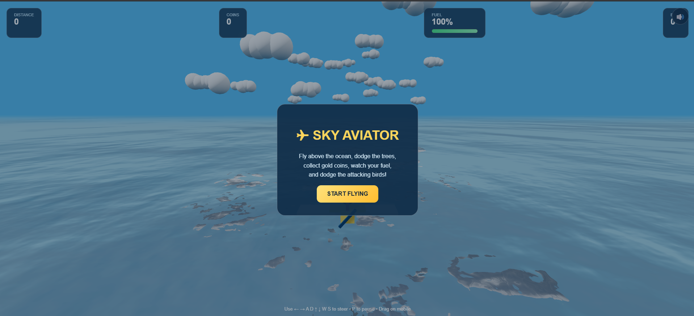
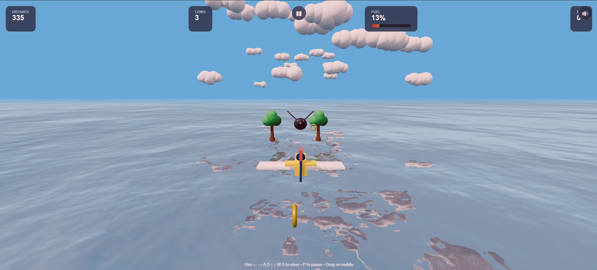
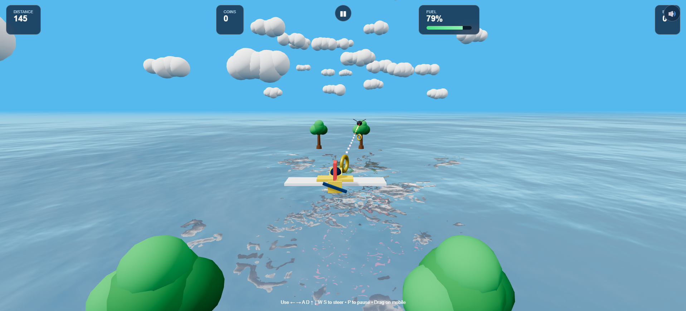

# ✈️ Sky Aviator

A fast-paced 3D endless flyer built with **Three.js**. Pilot a low-poly seaplane over a shimmering ocean, weave through trees, grab gold coins, keep your fuel topped up, and dodge kamikaze birds that telegraph their attacks with a white horizon line.


---

## 📑 Table of Contents

- [Features](#-features)
- [Demo](#-demo)
- [Getting Started](#-getting-started)
- [Controls](#-controls)
- [Gameplay Systems](#-gameplay-systems)
  - [Fuel System](#-fuel-system)
  - [Bird Attacks](#-bird-attacks)
  - [Trees & Obstacles](#-trees--obstacles)
  - [Collectibles](#-collectibles)
- [Technical Overview](#-technical-overview)
- [Project Structure](#-project-structure)
- [Configuration](#-configuration)
- [Browser Support](#-browser-support)
- [Known Limitations](#-known-limitations)
- [Roadmap](#-roadmap)
- [Credits](#-credits)
- [License](#-license)

---

## 🎮 Features

- **Realistic ocean rendering** using `THREE.Water` with animated normals and sun reflections
- **Full 3D plane model** — fuselage, wings, tail, cockpit, and spinning propeller
- **Dynamic difficulty** — speed ramps up as your distance grows
- **Fuel management** — drains over time, restored by pickup canisters
- **Telegraphed bird attacks** — 2-second warning with a targeting line, then a dodgeable dash
- **Procedurally-built trees** — low-poly obstacles that grow out of the water
- **Coin collection** with score tracking
- **Persistent high score** via `localStorage`
- **Pause menu** and **sound toggle**
- **Fully responsive** — works with keyboard, touch drag, and on-screen mobile buttons
- **Procedural audio** — all sounds generated with the WebAudio API, no external audio files

---
## Images






## 🕹 Demo

> Open `index.html` in any modern browser — no build step, no server required.

```
git clone https://github.com/<your-username>/sky-aviator.git
cd sky-aviator
# Open index.html directly, or serve locally:
python3 -m http.server 8000
# then visit http://localhost:8000
```

> ⚠️ The game loads Three.js from the jsDelivr CDN, so an internet connection is required on first load.

---

## ⌨️ Controls

| Action | Desktop | Mobile |
|--------|---------|--------|
| Steer left / right | `←` `→` or `A` `D` | `◀` `▶` buttons, or drag |
| Climb / dive | `↑` `↓` or `W` `S` | `▲` `▼` buttons, or drag |
| Pause / Resume | `P` | `❚❚` button |
| Start / Restart | Click **START FLYING** | Tap **START FLYING** |
| Toggle sound | `🔊` button | `🔊` button |

---

## 🎯 Gameplay Systems

### ⛽ Fuel System

Your plane starts with **100% fuel**. Fuel drains continuously based on your speed:

```
drain_per_second = BASE_DRAIN + (current_speed × SPEED_FACTOR)
```

- **Base drain:** 1.6% per second
- **Speed factor:** 0.06% per speed unit
- **Bird hit penalty:** −20% per hit
- **Refuel canister:** +35% per pickup

The HUD fuel bar changes color as you run low:

| Level | Color | Threshold |
|-------|-------|-----------|
| Normal | 🟢 Green | > 35% |
| Low | 🟠 Orange | 15–35% |
| Critical | 🔴 Red (pulsing) | ≤ 15% |

Running out of fuel ends the flight.

### 🐦 Bird Attacks

Birds use a two-phase attack, giving you a **clear dodge window**:

**Phase 1 — Telegraph (2 seconds)**
- Bird flies in from a random side and hovers ~25 units in front of you.
- A **white dotted horizon line** appears, tracking your live position.
- A warning beep plays as the telegraph begins.

**Phase 2 — Attack (1.2 seconds)**
- The line turns **red** and the bird locks onto a **snapshot** of your position.
- The bird dashes along the frozen line.
- **Dodging off the red line during this window = clean miss.**
- Landing within 1.4 units = one hit (−20% fuel).

Each bird can only land **one hit**.

### 🌳 Trees & Obstacles

- Trees spawn in pairs, leaving a **~5.2-unit gap** in the middle.
- Each tree is built from primitives: tapered trunk + root flare + 4 stacked foliage spheres.
- **Collision uses the trunk radius**, so clipping leaves won't end your run.
- Trees emerge from the ocean surface (`y = -4`).
- Spawn interval: **every 2.2 seconds**.

### 🪙 Collectibles

| Item | Effect | Spawn Rate |
|------|--------|------------|
| 🟡 Gold coin | +1 to coin count | Every 1.3s |
| 🟧 Refuel canister | +35% fuel | Every 9s |

---

## 🛠 Technical Overview

**Stack:**
- [Three.js r160](https://threejs.org/) — 3D rendering
- `THREE.Water` — ocean surface with animated normals
- WebAudio API — procedural sound effects
- Vanilla HTML/CSS/JS — no framework, no build step

**Rendering:**
- ACES Filmic tone mapping, sRGB output
- PCF Soft Shadow maps (2048×2048 directional light)
- Fog for depth and distance culling
- Pixel ratio capped at 2× for performance

**Architecture:**
- Single-file, ES module–based
- Import map for `three` / `three/addons/` resolution
- Object pools for obstacles, coins, refuels, birds
- Delta-time-based updates (frame-rate independent)

---

## 📁 Project Structure

```
sky-aviator/
├── index.html          # Entire game (HTML + CSS + JS module)
└── README.md
```

The game is intentionally a **single self-contained file** so it can be dropped onto any static host or opened directly from disk.

---

## ⚙️ Configuration

All tuning constants are declared near the top of the `<script type="module">` block. Useful ones:

```javascript
// Fuel
const FUEL_MAX            = 100;
const FUEL_DRAIN_BASE     = 1.6;   // %/sec baseline
const FUEL_DRAIN_SPEED    = 0.06;  // %/sec per speed unit
const FUEL_HIT_LOSS       = 20;    // % lost per bird hit
const REFUEL_AMOUNT       = 35;    // % restored per canister
const REFUEL_INTERVAL     = 9;     // seconds between refuel spawns

// Bird behavior
const BIRD_TELEGRAPH      = 2.0;   // seconds of warning
const BIRD_ATTACK_TIME    = 1.2;   // seconds of dash (dodge window)

// Speed
let speed = 19;                    // starting speed
// speed = Math.min(32, 19 + score/150);  // ramp-up formula
```

To tune the feel, adjust these values — no other code needs to change.

---

## 🌐 Browser Support

| Browser | Status |
|---------|--------|
| Chrome / Edge (Chromium) | ✅ Full support |
| Firefox | ✅ Full support |
| Safari 16+ | ✅ Full support |
| Mobile Safari / Chrome Android | ✅ Full support (touch controls) |

Requires **WebGL** and **ES Modules** with **import maps** (all modern browsers support this as of 2023).

---

## ⚠️ Known Limitations

- **Internet required on first load** — Three.js and water normal textures are loaded from CDN. To make it fully offline, vendor the dependencies locally.
- **No save-state for coins/fuel** — only the high score is persisted in `localStorage`.
- **No difficulty settings** — the ramp is fixed, though easy to tweak via the constants above.
- **Single-file design** — great for distribution, less ideal for a large codebase.

---

## 🗺 Roadmap

- [ ] Power-ups (shield, magnet, slow-motion)
- [ ] Day/night cycle with different lighting
- [ ] Additional bird types (dive bombers, formations)
- [ ] Leaderboard backend
- [ ] Offline-capable build with vendored assets
- [ ] Gamepad support
- [ ] Accessibility: reduced-motion mode, colorblind-safe palette

---

## 🙌 Credits

- **Three.js** — [threejs.org](https://threejs.org/)
- **Water shader** — [Three.js examples](https://threejs.org/examples/?q=water)
- **Water normal map** — courtesy of the Three.js example assets
- **Design & code** — *your name here*

---

## 📄 License

Released under the **MIT License**. See [LICENSE](LICENSE) for details.

---

<p align="center">
  <sub>Built with ☁️, 🌊, and a little bit of ⛽.</sub>
</p>
